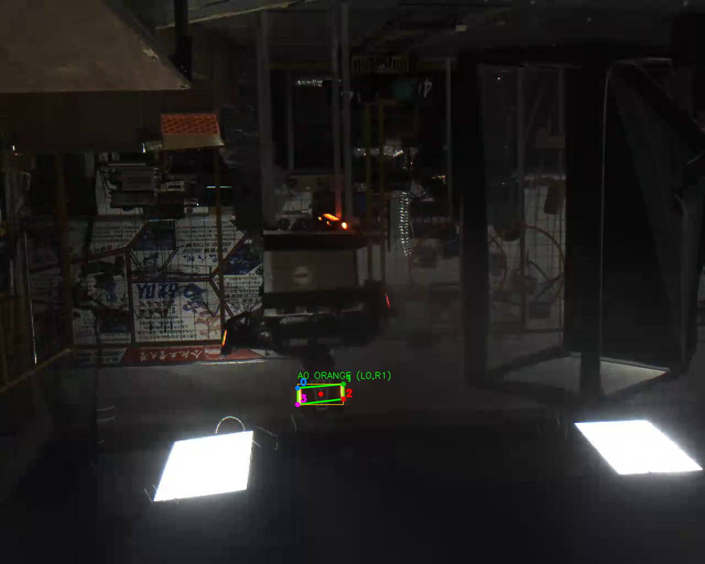
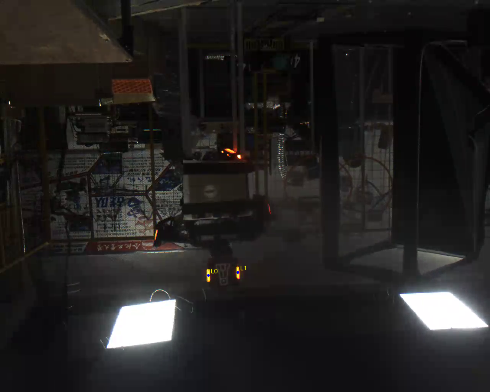
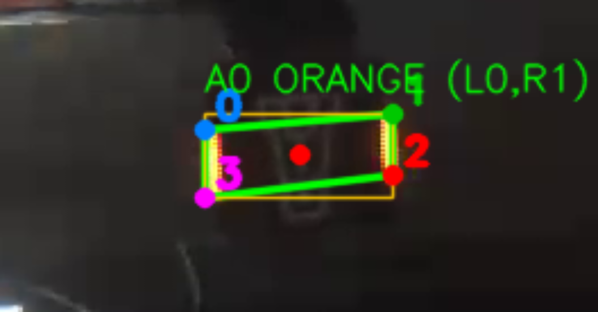

# armor_vision_detect

前哨站**静态图片**装甲板检测（C++17 + OpenCV 4，传统视觉，不用深度学习）。

输入一张彩色图片，程序自己完成：

```
颜色分割(mask) → 形态学清理 → 灯条候选(findContours) → 灯条配对 → 四角点排序 → 输出结果
```

不靠手画框、不写死任何坐标；换一张图、把图翻转或旋转，仍按同一套流程返回结果。
终端报告和 `output/report.txt` 内容一致，中间 mask、候选图、标注图都会保存。



---

## 一、环境与编译

| 项目 | 版本 |
| --- | --- |
| 系统 | Ubuntu 22.04 |
| OpenCV | 4.5.4（`sudo apt install libopencv-dev`） |
| CMake | 3.22 |
| 编译器 | g++ 11，C++17 |

```bash
cmake -S . -B build && cmake --build build -j8
```

也可以进 `build/` 目录执行老写法：

```bash
mkdir -p build && cd build && cmake .. && make && cd ..
```

## 二、运行

```bash
./build/armor_vision_detect images/outpost_frame.png
```

- 不传参数：打印用法并返回 `-1`；
- 图片路径不存在或不是图片：打印「读取图片失败」并返回 `-1`；
- 图片能读但没有候选：打印「没有检测到装甲板」，**正常返回 0**（不是崩溃）。

## 三、目录结构

```text
armor_vision_detect/
├── CMakeLists.txt
├── include/
│   └── armor_detector.h        # 参数、数据结构、类和函数的声明
├── src/
│   ├── main.cpp                # 读图、调用单帧接口、画图、打印/写报告
│   ├── armor_detector.cpp      # 检测总流程 + 灯条筛选 + 配对 + 四角点
│   ├── hsv_processor.cpp       # BGR → HSV → inRange → mask
│   ├── morphology_processor.cpp# 腐蚀/膨胀/开/闭
│   └── utils.cpp               # SaveImage、颜色名
├── images/
│   └── outpost_frame.png       # 本阶段验收输入（1280×1024，3 通道）
├── test_images/                # 自测用图（翻转、裁剪、旋转、全黑）
├── output/                     # 程序生成的 mask、候选图、结果图和报告
└── build/                      # 编译产物，可删除重编
```

## 四、输出文件

| 文件 | 内容 |
| --- | --- |
| `output/orange_mask.png` | 颜色分割后的原始 mask：白色 = 目标颜色，黑色 = 其它 |
| `output/orange_cleaned.png` | 开运算 + 闭运算清理后的 mask |
| `output/orange_overlay.png` | 清理后的 mask 盖回原图（红色），检查选中的是不是灯条 |
| `output/candidates.png` | 灯条候选：黄色旋转矩形 + 蓝色中心 + `L0/L1` 编号 |
| `output/result.png` | 最终结果：绿色四边形、黄色外接框、红色中心、`0~3` 四角点 |
| `output/armor_zoom.png` | 装甲板附近 4 倍放大，方便肉眼核对四角点顺序 |
| `output/report.txt` | 与终端完全相同的检测报告（颜色、外接框、中心、四角点、有效性、耗时） |




## 五、检测流程（每一步为什么这么做）

### 5.1 颜色分割：BGR → HSV → `inRange`

用 HSV 而不是直接对 BGR 三通道设阈值，是因为 H（色相）基本不受亮度影响；
前哨站画面很暗、还有反光，同一根灯条边缘和中心的 B 值差别很大，BGR 阈值很难同时包住。

- 目标灯条是橙色，实测 H≈25~33、S≈162、V≈239；
- 取 `H 8~40`（两边留余量）、`S ≥ 100`、`V ≥ 150`；
- 画面下方两块白色灯板很亮（V 很高），但几乎没有颜色（S 低），
  所以被 `S ≥ 100` 这一条排除掉了——这就是为什么不能只做亮度阈值；
- 中值滤波 `medianBlur(3)` 去掉灯条边上的零星噪点，同时不把边缘糊开。

本帧只有橙色灯条，所以**没有生成蓝色 mask**：强行生成也只会是一张全黑图，没有检查价值。
`HsvProcessor` 本身支持两段范围（红色 H 跨 0/180 时需要两段取并集），以后检测红/蓝装甲板时
只要在 `DetectorParams` 里改 `target_range` 和 `target_color`。

### 5.2 形态学清理

先开运算（去孤立噪点）再闭运算（补灯条断口），顺序不能反：
先闭会把噪点也膨胀成一团，再开就不一定去得掉了。核大小实测：

| 核大小 | 清理后白色像素 | 灯条候选 | 装甲板 | 说明 |
| --- | --- | --- | --- | --- |
| 1（等于不处理） | 675 | 2 | 1 | mask 上还留着零星噪点 |
| **3（当前）** | **541** | **2** | **1** | 噪点小于面积下限，被后续筛选丢弃 |
| 5 | 472 | 2 | 1 | 更干净，但灯条也变瘦，余量变小 |
| 7 | 71 | 0 | 0 | 灯条被吃掉，全流程失效 |

所以取 3：清理够用，又不会把本来就只有 ~100 像素的灯条继续削小。

### 5.3 灯条候选：轮廓 + 面积 + 长宽比 + 方向

对清理后的 mask 做 `findContours(RETR_EXTERNAL, CHAIN_APPROX_SIMPLE)`，对每个轮廓：

1. **面积** `contourArea` 在 100~400 之间——本帧两根灯条实测 158.5 和 120.5，更小的当噪点，更大的当背景结构；
2. **长宽比** `minAreaRect` 长边/短边在 2.5~8 之间——实测灯条 30×7（4.3）和 27×5（5.4），是细长条；
3. **方向** 轴对齐外接框必须「高 > 宽」——灯条在画面里是竖着的，横着的亮块直接排除。

结果：本帧得到 2 根灯条（`L0` 中心 (543.5, 719)，`L1` 中心 (620.5, 710.5)）。

### 5.4 灯条配对：7 个几何条件

两根灯条两两组合，同时满足以下条件才算一块装甲板：

| # | 条件 | 参数 | 本帧实测 |
| --- | --- | --- | --- |
| 1 | 颜色一致 | — | 都是橙 |
| 2 | 长度接近 | 长度比 ≤ 1.6 | 30/27 ≈ 1.11 |
| 3 | 方向平行 | 方向向量夹角 ≤ 15° | ≈ 0° |
| 4 | 基线不能太斜 | 中心连线倾角 ≤ 40° | 6.3° |
| 5 | 基线与灯条接近垂直 | 夹角与 90° 的偏差 ≤ 20° | 96.3°，偏差 6.3° |
| 6 | 间距/长度像装甲板 | 1.2 ~ 5.0 | 77/28.5 ≈ 2.7 |
| 7 | 整体宽高比像装甲板 | 1.2 ~ 6.0 | 83.4/28.5 ≈ 2.9 |

条件 4、5 是对任务书里「两根灯条中心上下偏差是否合理」的比例化表达。
最初写的是 `|Δy| / 灯条平均长度 ≤ 0.6`，把整张图旋转 20° 后同一块装甲板就判不出来了：
装甲板整体倾斜时 Δy 会随间距一起变大。改成角度以后，只和几何形状有关，
和图像尺寸、装甲板倾角都无关，`test_images/rotate-20.png`、`rotate+30.png` 都能稳定检出。

同一块装甲板可能被多组灯条重复配对（画面里灯条多的时候），
最后按「两个外接框重叠超过较小框的 50%」去重，只保留一个。
每个候选同时记录左/右灯条编号，结果图标签写成 `A0 ORANGE (L0,R1)`，方便核对配对是否正确。

### 5.5 四角点：固定「左上 → 右上 → 右下 → 左下」

每个灯条是一个 `RotatedRect`，有 4 个顶点。做法是：

1. 用两根灯条中心连线定义装甲板自己的 `axis_x`（指向右），
   把它在图像里顺时针转 90° 得到 `axis_down`（指向下，图像坐标 y 向下）；
2. 在两根灯条的 8 个顶点里，分别找沿「左上 / 右上 / 右下 / 左下」对角线方向最远的点：

   ```
   左上：max(-u-v)     右上：max( u-v)
   左下：max(-u+v)     右下：max( u+v)     (u, v = 顶点在 axis_x / axis_down 上的投影)
   ```

   这样不管装甲板往左歪还是往右歪，取到的都是灯条的**外侧**顶点，
   不会出现「同一块板，这次取外侧、下次取内侧」的情况；
3. 用鞋带公式检查绕向，保证 `0→1→2→3` 永远是顺时针（图像坐标 y 向下）；
4. 再检查 0、3 号点确实来自左灯条，1、2 号来自右灯条，不是的话直接丢弃这个候选。

本帧结果（可以直接和 `output/armor_zoom.png` 对照）：

| 编号 | 含义 | 坐标 |
| --- | --- | --- |
| 0 | 左上 | (540.0, 704.0) |
| 1 | 右上 | (623.0, 697.0) |
| 2 | 右下 | (623.0, 724.0) |
| 3 | 左下 | (540.0, 734.0) |

结果图上四个角点用不同颜色并标了 `0/1/2/3`；`output/armor_zoom.png` 是同一块区域的 4 倍放大。

**这个顺序是下一阶段 `solvePnP` 的输入约定**：四角点顺序必须和三维模型点一一对应，
顺序一乱，解出来的距离和朝向就会错，所以这里用「对角线极值 + 绕向检查 + 左右归属检查」三重保证，
而不是简单按 y 坐标排序（按 y 排在两灯条高度差很小或整块倾斜时会乱序）。

### 5.6 单帧接口（给下一阶段接视频用）

完整流程封装在 `ArmorDetector::Detect()` 里，输入一张 `cv::Mat`，输出 `DetectResult`：

```cpp
struct DetectResult
{
    std::vector<Armor> armors;          // 装甲板候选，可能为空
    std::vector<LightBar> light_bars;   // 灯条候选（调试用）
    cv::Mat color_mask;                 // 颜色分割 mask（调试用）
    cv::Mat cleaned_mask;               // 形态学清理后 mask（调试用）
};
```

下一阶段逐帧处理视频时只需要：

```cpp
armor_vision::ArmorDetector detector;          // 参数用默认值，构造一次
while (capture.read(frame))
{
    const auto result = detector.Detect(frame); // 每帧调用一次
    for (const auto& armor : result.armors)
    {
        // armor.center / armor.corners / armor.color 就是需要的输出
    }
}
```

`Detect()` 不读写文件、不依赖全局图片、不把任何坐标写死在代码里，
所以换图、翻转、裁剪、缩放（只要灯条面积还在阈值内）都会按同样流程返回结果。

## 六、参数一览（`include/armor_detector.h`）

| 参数 | 默认值 | 含义 |
| --- | --- | --- |
| `target_range` | H 8~40, S≥100, V≥150 | 目标颜色 HSV 范围 |
| `target_color` | Orange | 结果里标注的颜色 |
| `blur_kernel` | 3 | 中值滤波核，0 = 不滤波 |
| `morph_kernel` | 3 | 形态学核（见 5.2 的实测） |
| `min/max_light_area` | 100 / 400 | 灯条轮廓面积范围（像素） |
| `min/max_light_aspect` | 2.5 / 8.0 | 灯条长宽比范围 |
| `max_length_ratio` | 1.6 | 两根灯条长度比 |
| `max_angle_diff` | 15° | 两根灯条方向夹角 |
| `max_baseline_tilt` | 40° | 两灯条中心连线的倾角上限 |
| `max_perp_error` | 20° | 连线与灯条方向偏离 90° 的上限 |
| `min/max_spacing_ratio` | 1.2 / 5.0 | 灯条间距 / 灯条长度 |
| `min/max_armor_aspect` | 1.2 / 6.0 | 装甲板宽 / 高 |

调参只改这一个结构体的默认值，不要在各个函数里到处改常数。

## 七、测试记录

主验收图：`images/outpost_frame.png`（1280×1024，3 通道）。

| # | 测试 | 命令 / 改动 | 结果 |
| --- | --- | --- | --- |
| 1 | 主图正常检测 | `./build/armor_vision_detect images/outpost_frame.png` | 2 根灯条、1 块装甲板，退出码 0，耗时 ≈9.4 ms（无优化编译） |
| 2 | 图片不存在 | 路径改成 `images/not_exist.png` | 打印「读取图片失败」，退出码 -1，不崩溃 |
| 3 | 阈值检测不到目标 | 临时把 `min_light_area` 改成 100000 后重编 | 灯条 0、装甲板 0，打印「没有检测到装甲板」，退出码 0，不崩溃 |
| 4 | 全黑图 | `test_images/black.png`（640×480 全零） | 0 候选，正常返回 0 |
| 5 | 水平翻转 | `test_images/flip.png` | 1 块装甲板，中心 (697.0, 714.8)，坐标为镜像后的位置 |
| 6 | 裁剪 + 平移 | `test_images/crop.png`（400×250，目标被挪到左上） | 1 块装甲板，中心 (182.0, 114.8)，证明没有写死坐标 |
| 7 | 整图旋转 -20° | `test_images/rotate-20.png` | 1 块装甲板，四角点顺序仍为左上→右上→右下→左下 |
| 8 | 整图旋转 +30° | `test_images/rotate+30.png` | 1 块装甲板，四角点顺序不变 |

> 第 4~8 项是自测，不属于本阶段统一验收输入；它们主要用来检查
> 「坐标有没有写死」「倾斜时角点顺序会不会乱」「没有目标时会不会崩」。
> 第 3 项测试后已把 `min_light_area` 恢复为 100。

## 八、问题记录（实际遇到并修改的）

### 问题 1：白色灯板被当成目标

- **现象**：只按亮度或宽泛的 HSV 取 mask 时，画面下方两块白色灯板大片变白，灯条反而不突出。
- **原因**：白色灯板 V 很高（接近 255），但 S 很低（接近 0）；只看 V 分不开「亮」和「亮且有颜色」。
- **修改**：HSV 范围加 `S ≥ 100`、`V ≥ 150`，并保留 H 8~40。
- **结果**：mask 只剩 675 个白像素，两块白色灯板完全消失，两根灯条完整保留。
- **副作用**：距离很远、曝光不足时灯条 S/V 也会下降，阈值不能无脑调高；以后要做自动曝光/自适应阈值。

### 问题 2：mask 上的零星噪点与「小亮块」

- **现象**：原始 mask 上有若干 1~5 像素的小白点，`findContours` 会把它们也当成候选。
- **原因**：远处反光、传感器噪声；形态学开运算能去掉大部分，但开太大灯条也会被削。
- **修改**：核大小从 5 降到 3（实测表见 5.2），再靠 `contourArea ≥ 100` 和长宽比把残余小点筛掉。
- **结果**：清理后 541 个白像素里一共有 5 个轮廓：两根灯条（面积 158.5、120.5）和 3 个杂轮廓
  （面积 16、6、130）。面积 130 的那个是背景灯箱，尺寸 23×12、长宽比 1.9，
  被「长宽比 ≥ 2.5」和「外接框高 > 宽」这两条排除。最后灯条候选稳定为 2 个；
  核取 7 时灯条只剩 71 像素、候选变 0，说明不能只靠形态学。
- **副作用**：面积阈值是绝对像素值，换分辨率要重新标定（见「已知限制」）。

### 问题 3：同一块装甲板被重复配对

- **现象**：画面里灯条多于两根时，一对灯条可能被多组组合反复配成同一块装甲板，结果重复。
- **原因**：配对是两两穷举，只检查几何关系，没有「一块板只能出现一次」的约束。
- **修改**：候选按「外接框重叠超过较小框 50%」去重，只保留先出现的那一个；每个候选同时记录
  左/右灯条编号，结果图标签写成 `A0 ORANGE (L0,R1)`，方便核对到底是哪两根灯条配上了。
- **结果**：本帧 1 块；多灯条场景下不会重复输出同一块板。
- **副作用**：两块真实装甲板贴得很近、外接框重叠超过 50% 时可能被误合并，后续可以用中心距离/尺寸相似度改进。

### 问题 4：倾斜时四角点会取到灯条内侧的顶点

- **现象**：最初用「左灯条最上面的顶点」当左上角。灯条往一个方向歪时取到的是外侧角，
  往另一个方向歪时却取到内侧角，同一块装甲板的四角点会「缩进去」一点。
- **原因**：「最上面」是按图像 y 坐标找的，没有考虑装甲板自身的倾斜方向。
- **修改**：改成在装甲板自己的坐标系里，沿四条对角线方向取 8 个顶点的极值（见 5.5），
  再用鞋带公式检查绕向、检查 0/3 属于左灯条、1/2 属于右灯条。
- **结果**：`test_images/rotate-20.png`、`rotate+30.png` 下四角点顺序和语义都保持不变。
- **副作用**：灯条必须大致竖直（外接框高 > 宽），倾斜超过约 40~45° 会先被灯条筛选拒绝。

### 问题 5：整块装甲板倾斜时被「上下偏差」条件误杀

- **现象**：把整张图旋转 20° 后，两根灯条都检出了，但配对失败，装甲板候选为 0。
- **原因**：条件写的是 `|Δy| / 灯条平均长度 ≤ 0.6`。装甲板倾斜时 Δy 会随间距一起变大
  （旋转 20° 时 Δy 从 8.5 涨到 34），和灯条长度相比自然超限。
- **修改**：换成两个角度条件：中心连线倾角 ≤ 40°；连线方向与灯条方向夹角偏离 90° ≤ 20°。
  同时把「灯条是否平行」从「倾角绝对值差」改为「方向向量夹角」，避免一左一右歪的两根灯条被误判为平行。
- **结果**：旋转 ±10°、±20°、+30° 都能稳定检出 1 块装甲板，主图结果不变。
- **副作用**：条件比原来松，理论上「两根平行且间距合适、但属于不同装甲板」的灯条可能被配对；
  目前靠间距比、整体宽高比和去重兜底，下一阶段可以加 ROI/时序跟踪进一步约束。

### 问题 6：结果图上的中文变成问号

- **现象**：结果图标签使用 `cv::putText(ColorName(color))`，图上显示成 `A0 ??? (L0,R1)`。
- **原因**：OpenCV 的 `putText` 不支持中文字形，非 ASCII 字符会画成问号。
- **修改**：图片上的文字改用 ASCII 颜色名（`RED/BLUE/ORANGE`），终端和 `report.txt` 仍然是中文「橙」。
- **结果**：结果图和放大图上的标签完整可读。

## 九、已知限制与下一步

- **面积阈值依赖分辨率**：`min/max_light_area` 是绝对像素值，图像缩放后需要重新标定；
  更稳的做法是按图像面积比例或按灯条长度自适应。
- **只检测橙色**：本帧只有橙色灯条；检测红/蓝时改 `target_range`（红色需要两段 H 范围）和 `target_color`。
- **数字未识别**：`Armor::number` 固定为 -1，留待下一阶段做数字分类。
- **没有时序信息**：每帧独立检测，没有跟踪和预测；误检只能靠单帧几何条件压制。
- **大角度倾斜不支持**：灯条筛选要求外接框高 > 宽，装甲板旋转超过约 40~45° 会检测不到。
- **下一阶段**：接视频逐帧调用 `Detect()`，用 `Armor::corners`（左上→右上→右下→左下）做 `solvePnP`，
  再加 ROI 和跟踪。

## 十、提交内容对照

| 任务要求 | 本项目 |
| --- | --- |
| 源码 + CMake 工程 | `src/`、`include/`、`CMakeLists.txt` |
| 指定输入图片 | `images/outpost_frame.png` |
| 颜色 mask | `output/orange_mask.png`、`output/orange_cleaned.png` |
| 灯条候选图 | `output/candidates.png` |
| 最终标注图 | `output/result.png`、`output/armor_zoom.png` |
| 终端输出 | `output/report.txt`（与终端一致） |
| 问题记录 | 第八节，共 6 条 |
| 颜色分割/筛选/配对/角点说明 | 第五节 |
| 运行说明 | 第一、二节 |
